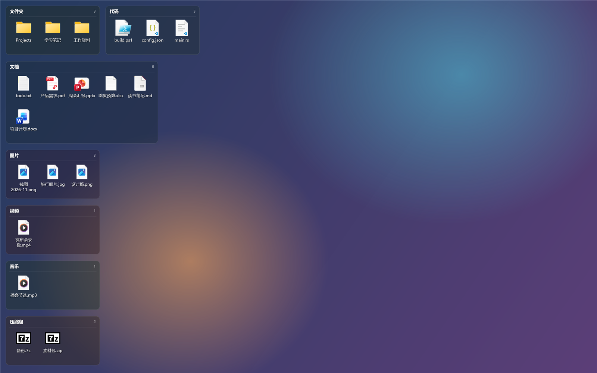

# NestDesk

**A fast, native desktop organizer for Windows — group your desktop icons into tidy, translucent boxes.**

English | [简体中文](README.zh-CN.md)

Screenshot made with sample files on a generated background.

## Why NestDesk

- **Native and light** — a single ~1.5 MB executable written in Rust (Win32 + Direct2D). No runtime, no web view, no background services.
- **Never moves your files** — boxes only group what is shown on the desktop. Files are moved or copied only when *you* drag files from elsewhere into a box.
- **Leaves your desktop as it was** — on first launch your icons keep the positions you gave them; nothing is organized until you click *Organize*. Quit NestDesk and the normal Windows desktop is back.
- **Works with live wallpapers** — boxes are truly translucent, so animated wallpapers (e.g. Wallpaper Engine) show through.

## Features

| | |
|---|---|
| **Boxes** | Drag the title bar to move (snaps to the work area), drag edges to resize, scroll with the wheel. Per box: fold, lock, rename, color, opacity, icon/list view, icons arranged across (row by row) or down (column by column, like the desktop), aligned left or right, sort by name/type/size/date or manual drag order. |
| **One-click organize** | Sorts desktop items into boxes by rules (apps, folders, documents, images, video, music, archives, code…). Rules are a plain JSON file you can edit. |
| **Folder boxes** | A box that shows the live contents of any folder. Network and removable drives are read in the background so the desktop never freezes. |
| **Same desktop as before** | Icons outside boxes are drawn exactly where Windows has them, with the system's spacing, font, shortcut arrows and UAC shields — starting NestDesk changes nothing you can see. Sorting and auto-arrange are passed to Windows, and icons you drag are saved back to the system desktop. |
| **Hide everything** | Double-click an empty spot on the desktop to hide or show all boxes and icons. |
| **Special boxes** | *Frequently used* (programs ranked by Windows usage counts + frequent folders, pin/remove), *Recent documents*, and local *Notes* with a small auto-saving note window. |
| **Windows 11 menus** | Every menu, including Explorer's own item menus, is shown as a Windows 11 style rounded acrylic menu that follows light/dark mode. |
| **Undo delete** | <kbd>Ctrl</kbd>+<kbd>Z</kbd> restores the last deleted items from the Recycle Bin, back into their box. |
| **Desktop search** | Press <kbd>Ctrl</kbd> twice (configurable). Searches the desktop, Start menu, Documents, Downloads, Pictures, Videos and Music; supports pinyin initials (`wx` → 微信). <kbd>Enter</kbd> opens, <kbd>Ctrl</kbd>+<kbd>Enter</kbd> opens the containing folder. |
| **Real shell integration** | Right-click shows the native Windows context menu (Open with, Send to, 7-Zip…). Drag and drop to and from Explorer and other apps. <kbd>Ctrl</kbd>+<kbd>C</kbd>/<kbd>X</kbd>/<kbd>V</kbd>, <kbd>Delete</kbd> (to Recycle Bin), <kbd>F2</kbd> rename, arrow keys, <kbd>Shift</kbd>/<kbd>Ctrl</kbd> multi-select, rubber-band selection. |
| **Frosted glass** (optional) | A per-box blurred wallpaper backdrop. Automatically falls back to plain translucency for live wallpapers, solid colors and slideshows. Off by default. |
| **Multi-monitor & HiDPI** | Box positions are stored as anchors per monitor layout; one uniform scale is used across monitors and re-checked when display settings change. |
| **Automatic updates** | On by default: NestDesk checks the official release page in the background, verifies the download against the published SHA-256, and installs it silently when you are away from the computer, then starts again with your boxes and settings. Turn it off in Settings, or use **检查更新** (check for updates) in the tray menu. |
| **Safe by design** | Layout backups and restore, pause (restore system icons) from the tray, start with Windows (opt-in). If anything goes wrong, `nestdesk.exe --restore` brings the system icons back. |

## Download

Get the latest installer from the [**Releases**](https://github.com/diobrando3379/nestdesk/releases/latest) page:

- `NestDesk-Setup-x.y.z.exe` — installer (per-user, no admin rights needed)
- `NestDesk-x.y.z-portable.zip` — just the executable

> [!NOTE]
> The binaries are not code-signed, so Windows SmartScreen may warn the first time. Click **More info → Run anyway**. You can verify the download with the published `SHA256SUMS.txt`.

The installer never adds a desktop shortcut or autostart entry unless you tick those options, and it does not launch NestDesk when it finishes. Uninstalling closes NestDesk, restores the system desktop icons, and asks whether to keep your layout (kept by default).

## Usage

| Action | How |
|---|---|
| Organize the desktop | Right-click an empty spot → **一键整理 (Organize)**, or use the tray menu |
| New box / folder box | Right-click an empty spot → **新建格子 / 新建文件夹映射格子** |
| Box options | Hover a box title for buttons (view · lock · fold · menu), or right-click the box |
| Hide / show everything | Double-click an empty spot |
| Search | Press <kbd>Ctrl</kbd> twice |
| Settings, backups, pause, quit | Tray icon (right-click) |

Data lives in `%APPDATA%\NestDesk`: `desk.json` (layout and settings), `rules.json` (organize rules), `backups\`, `nestdesk.log`.

The UI is currently Chinese (Simplified).

## Performance

Measured with the built-in offscreen benchmark (`nestdesk.exe --bench <seconds>`; it does not touch the real desktop) on a 3840×2160 desktop at 175 % scaling:

| | |
|---|---|
| Full 4K redraw | ~8 ms median |
| Hover redraw (dirty rect only) | ~1.9 ms |
| Memory | ~97 MB private; ~+40 MB once frosted glass is enabled |
| 1-hour steady state | private memory, kernel handles and GDI objects flat (0.000 MB/min over the last 40 min) |

NestDesk only redraws when something changes, so it is idle otherwise.

## Known limitations

- Windows 10/11 x64 only. UI text is Chinese only for now.
- Not code-signed (see the note under [Download](#download)).
- With monitors at different scaling factors, one uniform scale (the primary monitor's) is used.
- Frosted glass cannot blur a live wallpaper; it falls back to translucency there by design.

## Feedback

Found a bug or have an idea? Open an [issue](https://github.com/diobrando3379/nestdesk/issues).

## License

NestDesk is free to use, including at work; the source code is not published. See [LICENSE](LICENSE) for the full terms and [THIRD-PARTY-NOTICES.txt](THIRD-PARTY-NOTICES.txt) for the open-source components it includes.

NestDesk is independent software and is not affiliated with Tencent.

## Acknowledgements

NestDesk is built with:

- [windows-rs](https://github.com/microsoft/windows-rs) — Rust bindings for the Windows API
- [serde](https://serde.rs) / serde_json
- [embed-manifest](https://crates.io/crates/embed-manifest)
- [Inno Setup](https://jrsoftware.org/isinfo.php) and its community Chinese (Simplified) translation, used for the installer
