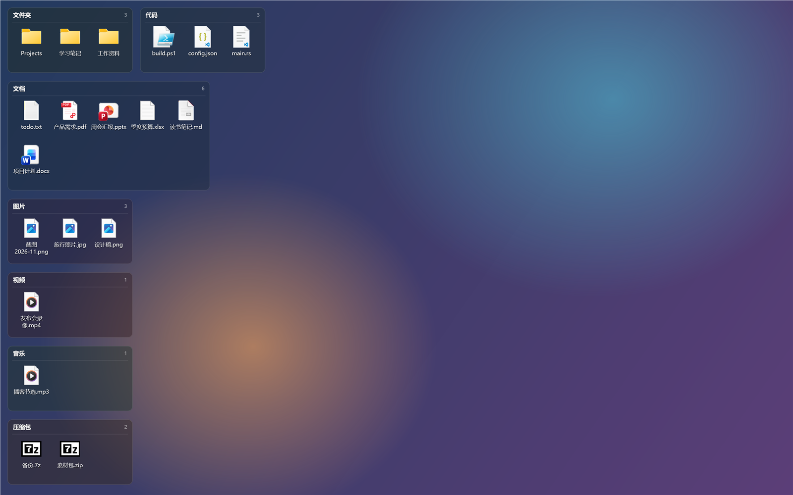

# NestDesk 栖格桌面

**原生、轻快的 Windows 桌面整理工具：把桌面图标收进整齐的半透明格子里。**

[English](README.md) | 简体中文

截图使用示例文件和程序生成的背景。

## 为什么选 NestDesk

- **原生、轻量**：用 Rust 写成（Win32 + Direct2D），单个 exe 约 1.5 MB；不需要运行库，不用网页内核，没有后台服务。
- **不会移动你的文件**：格子只是把桌面上显示的东西分组。只有当**你**把别处的文件拖进格子时，才会移动或复制文件。
- **不擅自改你的桌面**：第一次启动时图标保持你原来摆的位置，点"一键整理"之前什么都不会被整理；退出 NestDesk，系统桌面原样恢复。
- **支持动态壁纸**：格子是真正的半透明，Wallpaper Engine 之类的动态壁纸会透出来。

## 功能

| | |
|---|---|
| **格子** | 拖标题栏移动（自动限制在工作区内），拖边缘缩放，滚轮滚动。每个格子都可以收起、锁定、改名，调颜色和不透明度，切换图标/列表视图，图标可以横向排列（一行一行排）或竖向排列（一列一列排，和系统桌面一样），可以靠左或靠右，按名称/类型/大小/日期排序，或者拖动手动排序。 |
| **一键整理** | 按规则把桌面项目分到格子里（应用、文件夹、文档、图片、视频、音乐、压缩包、代码……）。规则是一个可以直接编辑的 JSON 文件。 |
| **文件夹映射格子** | 格子里实时显示任意文件夹的内容。网络和可移动磁盘上的文件夹在后台读取，不会卡住桌面。 |
| **桌面和原来一模一样** | 不在格子里的图标按系统桌面的实际位置和间距绘制，字体、快捷方式箭头、管理员盾牌都和系统一致，启动前后看不出任何变化；排序和自动排列交给系统，在 NestDesk 里拖动图标会写回系统桌面。图标放进格子后不会在桌面上留空位，剩下的图标按原来的顺序自动补上（可以关闭）。 |
| **一键隐藏** | 双击桌面空白处，隐藏或显示所有格子和图标。 |
| **特殊格子** | 「常用」（按 Windows 自己记录的使用次数排列软件，加上常用文件夹，可固定、可移除）、「最近文档」、本机「便签」（小便签窗口，自动保存）。 |
| **Win11 风格菜单** | 所有菜单（包括资源管理器自己的右键菜单项）都以 Win11 圆角亚克力样式显示，跟随系统深浅色。 |
| **撤销删除** | <kbd>Ctrl</kbd>+<kbd>Z</kbd> 从回收站还原刚删除的项目，并放回原来的格子。 |
| **桌面搜索** | 连按两次 <kbd>Ctrl</kbd>（可以改成其他快捷键）。搜索桌面、开始菜单、文档、下载、图片、视频、音乐，支持拼音首字母（`wx` → 微信）。<kbd>Enter</kbd> 打开，<kbd>Ctrl</kbd>+<kbd>Enter</kbd> 打开所在位置。 |
| **完整的系统集成** | 右键弹出的是系统原生菜单（打开方式、发送到、7-Zip……）；可以和资源管理器及其他程序互相拖放；支持 <kbd>Ctrl</kbd>+<kbd>C</kbd>/<kbd>X</kbd>/<kbd>V</kbd>、<kbd>Delete</kbd>（进回收站）、<kbd>F2</kbd> 重命名、方向键、<kbd>Shift</kbd>/<kbd>Ctrl</kbd> 多选、框选。 |
| **毛玻璃**（可选） | 每个格子单独生成模糊的壁纸底图。遇到动态壁纸、纯色或幻灯片背景时自动改为半透明。默认关闭。 |
| **多显示器与高 DPI** | 格子位置按显示器布局保存成锚点；多屏统一使用一个缩放比例，显示设置变化时重新检查。 |
| **自动更新** | 默认开启：在后台检查官方发布页，下载后按发布的 SHA-256 校验，等你离开电脑时静默安装，装完自动重新打开，格子和设置都保留。可以在设置里关闭，也可以在托盘菜单里点「检查更新」。 |
| **安全** | 布局备份与还原；托盘里可以随时暂停（恢复系统图标）；开机自启动需要手动开启。万一出问题，运行 `nestdesk.exe --restore` 就能把系统桌面图标找回来。 |

## 下载

到 [**Releases**](https://github.com/diobrando3379/nestdesk/releases/latest) 页面下载最新版本：

- `NestDesk-Setup-x.y.z.exe`：安装包（装在当前用户目录，不需要管理员权限）
- `NestDesk-x.y.z-portable.zip`：只有程序本身

> [!NOTE]
> 程序没有数字签名，第一次运行时 Windows 可能提示"Windows 已保护你的电脑"，点 **更多信息 → 仍要运行** 即可。可以用发布页里的 `SHA256SUMS.txt` 校验下载的文件。

安装时不勾选，就不会创建桌面快捷方式，也不会开机自启动；装完不会自动运行。卸载时会先退出 NestDesk、恢复系统桌面图标，并询问是否删除布局数据（默认保留）。

## 使用

| 操作 | 方法 |
|---|---|
| 整理桌面 | 桌面空白处右键 → **一键整理**，或用托盘菜单 |
| 新建格子 / 文件夹映射格子 | 桌面空白处右键 → **新建格子 / 新建文件夹映射格子** |
| 格子设置 | 鼠标移到格子标题栏会出现按钮（视图 · 锁定 · 收起 · 菜单），或者右键格子 |
| 隐藏 / 显示全部 | 双击桌面空白处 |
| 搜索 | 连按两次 <kbd>Ctrl</kbd> |
| 设置、备份、暂停、退出 | 右键托盘图标 |

数据保存在 `%APPDATA%\NestDesk`：`desk.json`（布局和设置）、`rules.json`（整理规则）、`backups\`（布局备份）、`nestdesk.log`（日志）。

## 性能

用内置的离屏基准测试测量（`nestdesk.exe --bench <秒数>`，不会动真实桌面），环境是 3840×2160、175% 缩放：

| | |
|---|---|
| 整屏 4K 重画 | 中位数约 8 ms |
| 鼠标悬停（只重画变化区域） | 约 1.9 ms |
| 内存 | 私有内存约 97 MB；开启毛玻璃后约多 40 MB |
| 1 小时稳态测试 | 私有内存、内核句柄、GDI 对象都保持平稳（最后 40 分钟 0.000 MB/分钟） |

NestDesk 只在有变化时才重画，其余时间处于空闲状态。

## 已知限制

- 只支持 Windows 10/11 x64；界面目前只有中文。
- 没有数字签名（见[下载](#下载)里的说明）。
- 多台显示器缩放比例不同时，统一使用主屏的缩放比例。
- 毛玻璃无法模糊动态壁纸，这种情况下按设计改为半透明。

## 反馈

发现问题或有建议，欢迎提交 [Issue](https://github.com/diobrando3379/nestdesk/issues)。

## 许可

NestDesk 可以免费使用（包括用于工作），不开放源代码。完整条款见 [LICENSE](LICENSE)，所含开源组件的声明见 [THIRD-PARTY-NOTICES.txt](THIRD-PARTY-NOTICES.txt)。

NestDesk 是独立开发的软件，与腾讯公司没有任何关联。

## 致谢

NestDesk 使用了：

- [windows-rs](https://github.com/microsoft/windows-rs)：Windows API 的 Rust 绑定
- [serde](https://serde.rs) / serde_json
- [embed-manifest](https://crates.io/crates/embed-manifest)
- [Inno Setup](https://jrsoftware.org/isinfo.php) 及其社区贡献的简体中文翻译，用于制作安装包
